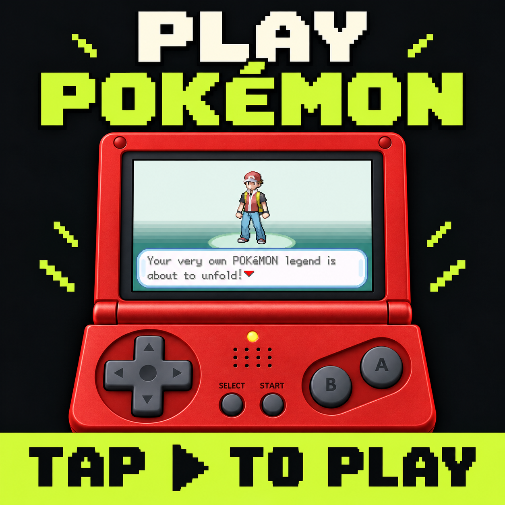
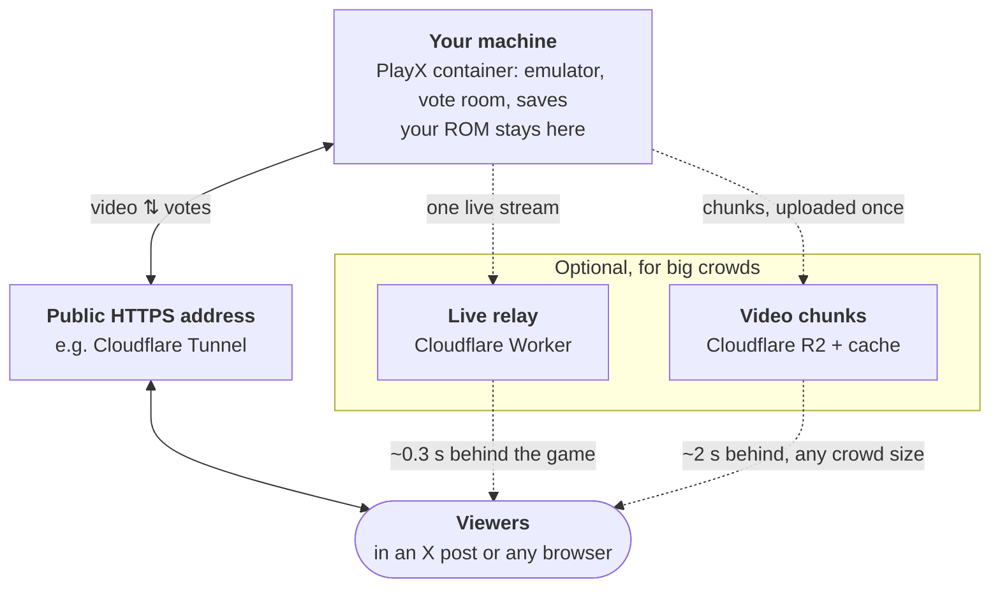

# PlayX

**One Game Boy Advance game, played by everyone watching, live inside an X post.**

**[▶ Play the live game](https://playx.stormster.dev)**: Pokémon FireRed, with everyone else who's on.

You post a link on X, and the post turns into a little handheld console. Anyone scrolling past can
tap play and join in. There's only one game, and everyone controls it together: each person votes
for the next button, and the crowd's choice gets pressed. It's like Twitch Plays Pokémon, but in the
timeline, with no stream software and no chat bot.

The game runs on your own computer. Viewers only ever receive video and send votes; the game file
never leaves your machine. PlayX was built for Pokémon FireRed and runs any Game Boy Advance game you
own.

<p align="center"><a href="https://playx.stormster.dev"></a></p>

## What you get

- **Two ways to play together.** In **Democracy**, the most-voted button wins every 1.5 seconds. In
  **Anarchy**, every press goes in (with limits, so no one can flood it). The crowd votes to switch
  between them.
- **Plays right in the post.** On X it plays inside the post. Anywhere else it's a normal web page
  you can open full screen or embed in your own site.
- **Hard to wreck.** The game saves itself every minute and you can roll back to any of those saves
  from the last 3 hours. In FireRed, if the crowd releases a Pokémon, PlayX undoes it automatically.
- **Cheap to run.** One Docker container on a home server, NAS or small VPS. The game pauses itself
  when nobody's watching. For big crowds, free Cloudflare services can carry the video so your
  internet upload doesn't have to.

## Quick start

You need [Docker](https://docs.docker.com/get-docker/) and a GBA **ROM** (the game file, ending in
`.gba`) for a game you own.

```bash
git clone https://github.com/Stormster/playx.git && cd playx
./setup.sh ~/path/to/your-game.gba     # makes folders, copies the ROM, writes settings
docker compose up -d                   # starts the game in the background
```

Open <http://localhost:8787> to play. The host controls are at <http://localhost:8787/admin>; the
password (the "admin token") is printed by `setup.sh` and saved in the `.env` file. On your own, you
are the whole crowd, so every vote you cast wins.

**To share it on X**, the game needs a public web address. [docs/deploy.md](docs/deploy.md) walks
through that with a free Cloudflare Tunnel (no router setup needed), then the optional extras for
big crowds.

## How it works



**One button press, start to finish:**

1. A viewer taps **A**. A few bytes go to your machine through the public address.
2. In Democracy, votes are counted for 1.5 s and the most popular button wins. In Anarchy, the press
   goes in right away.
3. The emulator (the program that plays the GBA game, here [mGBA](https://mgba.io)) presses the
   button, and the next frames go out to every viewer at about 30 frames a second.

On its own, your machine sends video to each viewer itself, which is fine for a small crowd. With the
optional Cloudflare pieces, it sends one copy and Cloudflare passes it on to everyone. Viewers use the
live relay while it's up and switch to chunks by themselves when it isn't.

The game keeps running while anyone is watching and freezes 30 s after the last viewer leaves, so an
empty room costs nothing. Restarts and updates save first and pick up from that save, so viewers
miss a few seconds of stream and no game progress.

## Under the hood

### The emulator

The Docker build compiles mGBA's [libretro](https://www.libretro.com) core, a plain library version
of the emulator. The Python server (`server/emu.py`) loads it with `ctypes` and steps it one frame at
a time on its own thread, holding down whichever buttons won. One server process runs one game.

### Votes

Each viewer keeps a WebSocket (`/ws`) open to the server and sends small JSON messages: a vote, a mode
preference, a hello. The server (`server/run.py`, built on `aiohttp`) decides what gets pressed:

- **Democracy:** votes are tallied per 1.5 s window (changeable on the admin page) and the top button
  is pressed. Start and Select need twice the votes of the runner-up, so a few people can't keep
  opening menus. The host can also let viewers vote for ×2, ×3 or ×5 steps in one direction.
- **Anarchy:** each press goes into a short queue, at most one press per player every 0.25 s.
  Holding a button repeats for up to 3 s, then rests for 2 s.
- **Fairness:** only three voters per IP address count in each window, and Anarchy presses are capped
  per IP, so one person with many tabs can't take over.
- **Switching modes:** viewers who pick a side vote on the mode. A switch needs 60% for 10 s in a row,
  then the mode is locked for 10 minutes.

### Video and sound

The server keeps every second frame (about 30 fps) at the GBA's 240×160 resolution and sound at
16 kHz mono. Each frame becomes one small binary **packet**:

```
[kind: key or delta][audio length][sequence number][sound (mu-law)][picture (zlib)]
```

A **key** packet holds the whole picture, compressed. A **delta** packet holds only what changed: the
frame is XORed with the one before, which is almost all zeros in a mostly-still game, so it
compresses to very little. Browsers decode the packets in JavaScript, draw them on a `<canvas>` and
play the sound through the Web Audio API.

Those packets reach viewers in one of two ways:

- **Chunks** (`server/chunks.py`): 60 packets (~2 s), starting with a key packet, in one file. With no
  R2 set up, the server keeps them in `data/cdn` and serves them at `/cdn`. With R2, it uploads each
  chunk once, Cloudflare's cache serves it to any number of viewers, and the server deletes it after
  5 minutes. Chunks are only made while someone is watching.
- **Live relay** (`relay/`, `server/relay.py`): the server keeps one WebSocket open to a Cloudflare
  Worker and sends packets as they're made. A Durable Object (one long-lived instance per game) passes
  each packet to every viewer and remembers the latest key packet and the deltas since, so someone
  joining mid-stream sees the picture straight away. With no viewers it sleeps and costs nothing.

Each browser follows the live relay when it can and falls back to chunks when the relay stalls,
drops or is over its free limits, then switches back by itself.

### Saves

Saves are emulator **savestates**: a snapshot of the whole console, restorable to the exact frame.
The server takes one every 10 s in memory, writes one to `data/` every minute (the last 3 hours are
kept, plus one per hour forever) and one on every stop. Rollback on the admin page restores any of
them, with a thumbnail of each.

The **release guard** reads FireRed's memory every half second and counts the Pokémon in your party
and PC. If the count drops, it restores the in-memory snapshot from 20 s earlier.

### The X card

`web/index.html` carries X's **Player Card** tags: X shows the image, and where it supports it, plays
the `/embed` page inside the post in a frame. The server fills in the page's public address
(`XP_ORIGIN`) so the tags have full links. X decides where the player shows up, so check your own
post on x.com and in the phone apps before you announce it.

## The admin page

At `/admin`, unlocked with the admin token:

- Pause, game speed 1x to 4x, ×2/×3/×5 step votes, and a colour theme for everyone (Flame Red, Cobalt, Graphite, Pearl,
  PlayX lime).
- Force Democracy or Anarchy, set the vote window, and set how long a mode switch locks.
- Rollback with thumbnails: every minute for 3 hours, then hourly forever.
- The run clock (play time, counted only while people are playing) and the empty-room timer.
- The release guard, and simulated players (bots that press buttons) to fill a quiet room.

Settings survive restarts. Before going public, put the admin page behind a login: see
[docs/deploy.md](docs/deploy.md#3-lock-down-the-admin-page).

## Other games

Any GBA game you own will run. Two extras were written for Pokémon FireRed (US version) only:

- **Release guard** (on by default): if the crowd releases one of your Pokémon, PlayX rewinds 20
  seconds to undo it. It notices by counting your Pokémon in the spot where FireRed stores them in
  the console's memory. Other games keep unrelated data in that spot, so the guard could see a
  "drop" that never happened and rewind for no reason. **Turn it off on the admin page when you run
  any other game.**
- **Name filter** (`server/names.py`): replaces rude trainer and Pokémon names. It's switched off and
  needs a code change to turn on, so you can ignore it.

The page text and the X card image (`web/index.html`, `web/social/`) mention Pokémon. Change them
for your game.

## Docs

| | |
| --- | --- |
| [docs/deploy.md](docs/deploy.md) | Going live: public address, admin login, posting on X, R2, relay, updates |
| [docs/configuration.md](docs/configuration.md) | Every setting in `.env` |
| [tests/README.md](tests/README.md) | Running the test suites |

## Repo

| Path | What |
| --- | --- |
| `server/` | Python server: emulator, votes, saves, release guard, run clock, video, admin API |
| `web/` | The handheld page: full page, `/play` (full screen) and `/embed` (inside the X card) |
| `relay/` | Optional live relay: a Cloudflare Worker and Durable Object that pass the video on |
| `Dockerfile` | Builds mGBA's libretro core and the server image. The ROM is never in the image. |
| `docker-compose.yml` | The game, plus optional Cloudflare Tunnel and Watchtower (auto-updates) |
| `setup.sh` | First-time setup |
| `tests/` | Python and browser tests, all with a fake emulator (no ROM needed) |

## Development

```bash
pip install numpy==2.1.3 aiohttp==3.10.11 pillow==11.0.0
python3 server/run.py --rom path/to/game.gba --core path/to/mgba_libretro.so --data ./data/dev
python -m unittest discover -s tests -v
```

The libretro core comes from the Docker build (`/app/core/mgba_libretro.so`) or your own mGBA build
with `-DBUILD_LIBRETRO=ON`. With `XP_ADMIN_HOST` unset, the admin page works on localhost.
`server/prep.py` drives the emulator directly, without a crowd. Merges to `main` build the image
`ghcr.io/<owner>/<repo>` (amd64 and arm64) with GitHub Actions, so a fork publishes its own.

## Ground rules

- **Bring your own ROM.** No game files are included or ever sent to viewers; only video leaves your
  machine. Only use games you own.
- PlayX is a fan project, not affiliated with Nintendo, Game Freak, The Pokémon Company or X.

## License

[MIT](LICENSE). Made by [@Stormster](https://github.com/Stormster) ·
[@StormsterDev](https://x.com/StormsterDev) on X.
